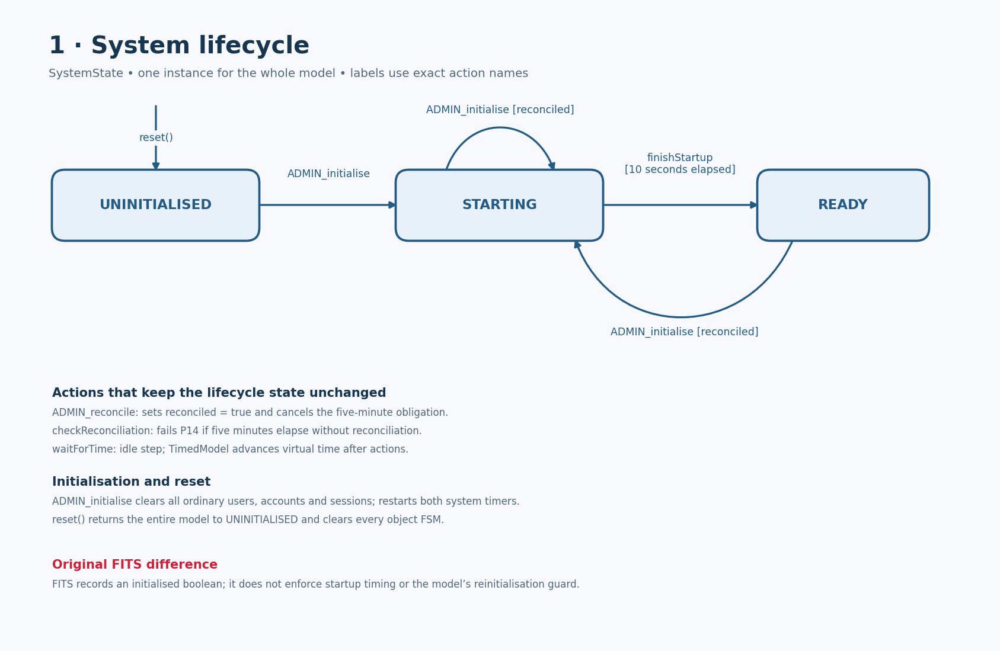
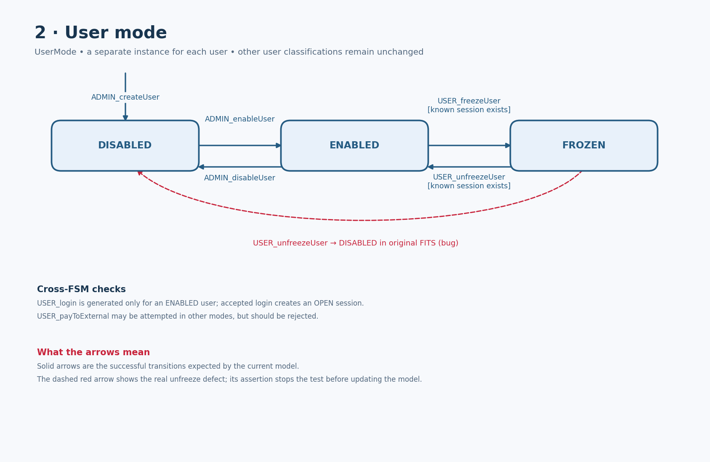
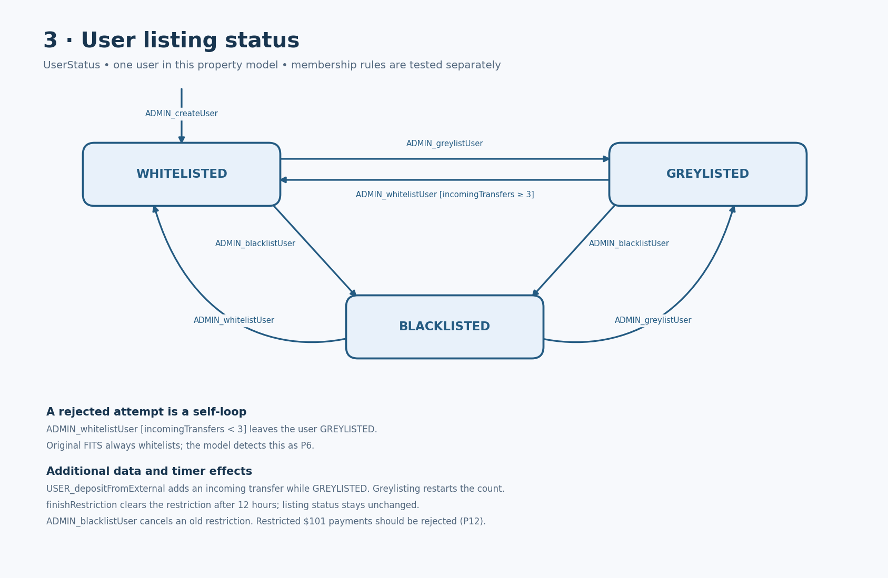
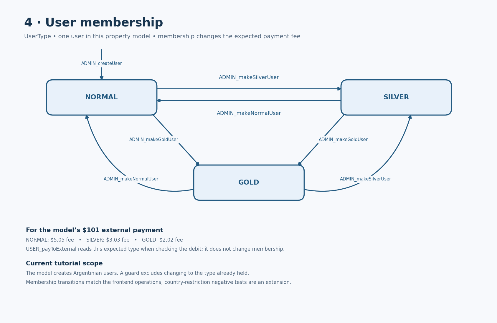
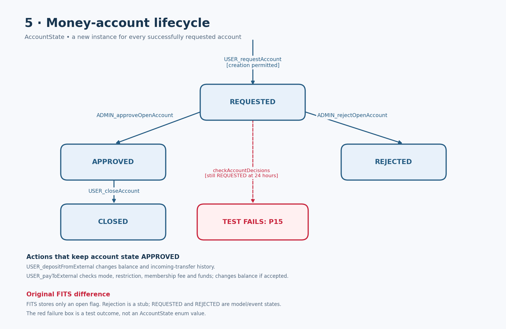
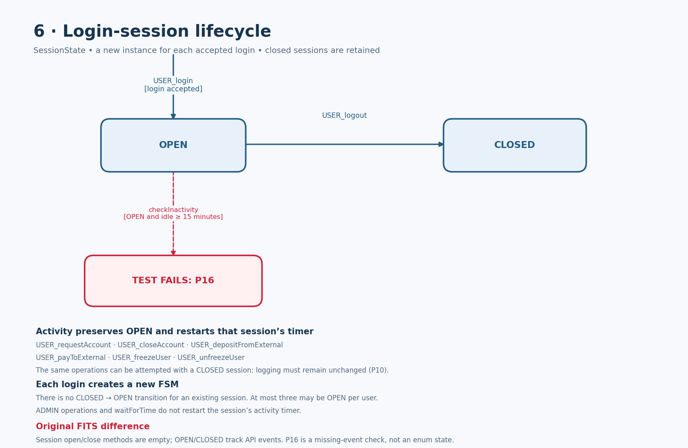

# FITS ModelJUnit tutorial

An in-memory banking example checked by five small, timed ModelJUnit FSMs. Each JUnit test focuses on a few properties; see [the separate FSM models](#the-separate-fsm-models).

## What FITS does

An administrator creates and enables users, changes their classification, and
approves or rejects money accounts. Users log in, request accounts, deposit money,
pay bills, transfer money and log out. Membership determines payment fees.
`FrontEnd` is the Java API that a client interface could call. There is no database,
real banking network, graphical interface or application `main()`.

The implementation is copied from the book's chapter 10. Its defects and missing
policy checks are retained so students can discover counterexamples.

| Implementation file | Purpose |
|---|---|
| `TransactionSystem.java` | Creates and connects the frontend and backend. Construction does not initialise the administrator's system. |
| `FrontEnd.java` | Public administrator and user operations. Model actions call this API. |
| `BackEnd.java` | Stores users, allocates IDs and performs initialisation. Tests use getters to observe results. |
| `UserInfo.java` | One user's mode, listing status, membership, accounts, sessions and fee calculation. |
| `BankAccount.java` | Account number, owner, open flag and balance. |
| `UserSession.java` | Session owner, ID and operation log. Open/close methods are empty observation points. |

## FSM enums and model variables

Each diagram has its own enum class: [`SystemState.java`](src/test/java/fits/model/enums/SystemState.java),
[`UserMode.java`](src/test/java/fits/model/enums/UserMode.java),
[`UserStatus.java`](src/test/java/fits/model/enums/UserStatus.java),
[`UserType.java`](src/test/java/fits/model/enums/UserType.java),
[`AccountState.java`](src/test/java/fits/model/enums/AccountState.java) and
[`SessionState.java`](src/test/java/fits/model/enums/SessionState.java). Each model keeps rule data such
as balances, counters and deadlines in separate fields. Those fields help guards and assertions
decide whether an action is allowed and what result is expected; they are not automatically extra
FSM states.

ModelJUnit treats the value returned by `getState()` as the graph node identity. A model for one
FSM returns that FSM's enum (plus an initial fixture state where needed). A test that intentionally
combines FSMs defines a small local enum for their product, such as system lifecycle × user mode.
The session test combines the states of its dynamically created session instances by open/closed
counts. These are abstract graph states: different values of a counter or timer can share one graph
node. As a result, graph state coverage does not prove that every numeric boundary was explored;
the generated action sequence must still exercise those rule variables.

## Rules represented

| Rule | What the rule means | Test file | How the model checks it |
|---|---|---|---|
| **P2 — Initialise before login** | An enabled user must not be able to open a session before the transaction system has been initialised. Enabling the user alone is not sufficient. | [`SystemTimingModelTest.java`](src/test/java/fits/model/SystemTimingModelTest.java) | `USER_login` allows the attempt but expects rejection while the system is `UNINITIALISED`. An accepted login at this point fails the assertion. |
| **P5 — No withdrawals while disabled** | After the administrator disables a user, the user must not withdraw money until enabled again. An existing session does not grant permission to continue withdrawing. | [`DisabledPaymentModelTest.java`](src/test/java/fits/model/DisabledPaymentModelTest.java) | `USER_payToExternal` attempts a payment and expects rejection when the user is `DISABLED`. It checks that the payment is rejected and that the account balance is unchanged. This model also exercises membership fees. |
| **P6 — Three incoming transfers before whitelisting** | A greylisted user must receive at least three incoming transfers before being whitelisted. Entering `GREYLISTED` starts a new count for that user. | [`ListingPolicyModelTest.java`](src/test/java/fits/model/ListingPolicyModelTest.java) | `USER_depositFromExternal` counts incoming deposits while greylisted. `ADMIN_whitelistUser` expects the status to remain `GREYLISTED` below three transfers, and permits `WHITELISTED` once the count reaches three. |
| **P7 — Ten account requests per session** | A user may request at most ten new money accounts through a particular session. This model uses one session, so it does not compare allowances across sessions. | [`AccountRequestModelTest.java`](src/test/java/fits/model/AccountRequestModelTest.java) | The model maintains the request count for its one session. It permits at most one undecided request at a time; after ten accepted requests, another request should be rejected. |
| **P9 — Three concurrent sessions per user** | A user may have several sessions, but no more than three may be open simultaneously. Logging out frees a place; retaining a closed session record does not use that place. | [`SessionModelTest.java`](src/test/java/fits/model/SessionModelTest.java) | `USER_login` counts the user's `OPEN` session FSMs and expects a fourth concurrent login to be rejected. `USER_logout` changes one session to `CLOSED`. |
| **P10 — Logging only in an active session** | Operations must not append entries to a session's log after that session has been closed. Knowing an old session ID does not make it active again. | [`SessionModelTest.java`](src/test/java/fits/model/SessionModelTest.java) | The model retains closed session IDs and tries `USER_requestAccount` through one. It compares the session log before and after the call. |
| **P11 — Ten-second startup period** | Even after initialisation, no session should open during the first ten seconds. Login becomes eligible once this startup period has completed. | [`SystemTimingModelTest.java`](src/test/java/fits/model/SystemTimingModelTest.java) | `ADMIN_initialise` starts a ten-second timer. `USER_login` expects rejection while the system is `STARTING`; `finishStartup` moves it to `READY` at the deadline. |
| **P12 — Twelve-hour transfer restriction** | When a blacklisted user is whitelisted, that user must not perform a single external transfer above $100 for the next twelve hours. The limit concerns the transfer amount, not its fee. | [`ListingPolicyModelTest.java`](src/test/java/fits/model/ListingPolicyModelTest.java) | `ADMIN_whitelistUser` starts the restriction. The model attempts a $101 payment and expects rejection while restricted; `finishRestriction` clears the restriction after twelve hours. |
| **P13 — Three creations in a rolling day** | A user may have at most three money accounts created within any rolling 24-hour period. This is a moving window, rather than an allowance that resets at midnight. | [`AccountRequestModelTest.java`](src/test/java/fits/model/AccountRequestModelTest.java) | The model counts creations in the rolling window and expects another request to be rejected at three. `expireCreations` removes timestamps aged 24 hours. |
| **P14 — Reconcile within five minutes** | An administrator must perform reconciliation within five minutes of initialisation. This checks an obligation on the generated administrator schedule. | [`SystemTimingModelTest.java`](src/test/java/fits/model/SystemTimingModelTest.java) | `ADMIN_initialise` starts the deadline; `ADMIN_reconcile` records the event and cancels it. `checkReconciliation` fails if reconciliation is missing at the deadline. |
| **P15 — Decide an account request within a day** | Each requested money account must be approved or rejected within 24 hours of its creation. This model permits only one pending request at a time. | [`AccountRequestModelTest.java`](src/test/java/fits/model/AccountRequestModelTest.java) | Approval or rejection clears the pending request; `checkDecision` fails if it remains `REQUESTED` at its 24-hour deadline. |
| **P16 — Close an idle session within fifteen minutes** | Each session must be closed within fifteen minutes of inactivity. Activity in one session must not keep another session alive. | [`SessionModelTest.java`](src/test/java/fits/model/SessionModelTest.java) | The model tracks a deadline for every `OPEN` session. An account request refreshes only the session used; `checkInactivity` fails if a session remains open at its deadline. |

The original unfreeze operation wrongly disables the user, but unfreezing is not included in these property models.


## The separate FSM models

The model is split into five independently runnable tests. Each one holds
unrelated parts of FITS fixed so ModelJUnit does not compose every user's mode,
listing, membership, account and session state into one enormous state space.

The table records one sample `mvn test` run. Each model uses a fresh random seed,
so graph sizes can vary; the runner prints each seed so that run can be repeated.
Every graph in this sample reported `complete=true`.

| Test file | Rules | Main FSM states | Sample graph | Seed |
|---|---|---|---:|---:|
| `SystemTimingModelTest.java` | P2, P11, P14 | Product enum for system lifecycle and optional user mode | 9 states, 22 transitions | `664546202310781564` |
| `SessionModelTest.java` | P9, P10, P16 | Product of up to four `OPEN`/`CLOSED` session enum states | 15 states, 28 transitions | `5824310973383486344` |
| `DisabledPaymentModelTest.java` | P5 | Product enum for user mode and membership | 7 states, 22 transitions | `-5610585016981487481` |
| `ListingPolicyModelTest.java` | P6, P12 | `UserStatus`; transfer count and restriction timer are variables | 4 states, 9 transitions | `9139152290191636370` |
| `AccountRequestModelTest.java` | P7, P13, P15 | `AccountState`; request counts and deadlines are variables | 6 states, 11 transitions | `5704358243483701813` |

The account graph includes `NO_SESSION` and `NO_ACCOUNT` setup states in addition
to the four `AccountState` values. These totals describe the enum/composite graph
abstraction; they do not count every possible balance, counter or timer value.

The diagrams below show the expected object FSMs used across those models. They
are views of the rules, not a claim that one runner explores every combination.
One test file can model more than one FSM when they are needed together. For
example, `SystemTimingModelTest` has the system lifecycle and a user's enabled
state, while `DisabledPaymentModelTest` has the user's mode and membership FSMs.
Each class has its own `runModelJUnit()` method and constructs its own `TimedModel`.

| FSM / diagram | Test file(s) | What the test represents |
|---|---|---|
| System lifecycle | [`SystemTimingModelTest.java`](src/test/java/fits/model/SystemTimingModelTest.java) | `UNINITIALISED`, `STARTING`, `READY`, plus the user's enabled state needed for login. |
| User mode | [`SystemTimingModelTest.java`](src/test/java/fits/model/SystemTimingModelTest.java), [`DisabledPaymentModelTest.java`](src/test/java/fits/model/DisabledPaymentModelTest.java) | Both use `DISABLED` and `ENABLED`. The diagram's `FROZEN` and unfreeze transitions are not modeled in these tests. |
| User listing status | [`ListingPolicyModelTest.java`](src/test/java/fits/model/ListingPolicyModelTest.java) | A new user starts `WHITELISTED` via `ADMIN_createUser`; the model also represents `GREYLISTED`, `BLACKLISTED`, the P6 transfer count, and the P12 restriction timer. |
| User membership | [`DisabledPaymentModelTest.java`](src/test/java/fits/model/DisabledPaymentModelTest.java) | `NORMAL`, `SILVER`, and `GOLD`, used to check payment fees alongside P5. |
| Money-account request | [`AccountRequestModelTest.java`](src/test/java/fits/model/AccountRequestModelTest.java) | One account lifecycle moves through `REQUESTED`, `APPROVED`, `REJECTED` or `CLOSED`. A new request replaces the lifecycle currently shown; the model does not retain every account instance. |
| Login sessions | [`SessionModelTest.java`](src/test/java/fits/model/SessionModelTest.java) | Each session has its own `OPEN` or `CLOSED` state and inactivity deadline. |

### System lifecycle



### User mode



### User listing status



### User membership



### Money accounts



### Login sessions



The payment and listing-policy models each use one active session and one approved account as fixtures.
The account-request model also has one user and one session, and keeps only one
request pending at a time. It still checks request limits and decision deadlines,
while avoiding combinations of many simultaneous account lifecycles. The session
model retains each created session's own `OPEN` or `CLOSED` state and inactivity
time. The startup model contains no account or session collection.

The models intentionally keep balances, counters and clock values out of their
graph-state enums. Actions still use these state variables in guards and checks.
This is an abstraction: graph exploration can merge two situations whose counter
or timer values differ, so state coverage alone does not show that every numeric
boundary was reached. The three incoming-transfer counter is capped at three
because larger values are equivalent for P6. See [diagram notes](docs/fsm/README.md)
for diagram scope.

## Reading the test files

Each model file follows the same pattern:

1. The shared enums name the six base FSMs. A test-local enum combines base states
   when a test deliberately models more than one FSM; other fields hold model data
   such as counters, balances and deadlines.
2. `getState()` returns the FSM enum or composite enum that ModelJUnit uses as the
   graph-state key. The data fields still influence guards and property checks.
3. `reset(boolean testing)` clears that model. ModelJUnit uses `testing=false` to
   build the graph without calling FITS; generated conformance runs use
   `testing=true` and create a fresh `TransactionSystem`.
4. Each guard and `@Action` sit together. Actions execute the operation on the real
   `FrontEnd`, update the expected model, then compare the SUT with the model. Fixture
   actions keep unrelated objects fixed for that model.
5. `@Time` and `@Timeout` represent virtual time. There are no sleeps. ModelJUnit
   advances time after actions and can jump to an enabled timeout.
6. `FitsModelRunner` contains the small amount of runner setup shared by the five
   files: graph construction, a 100-action generated run and coverage metrics.
   It prints each transition as Time, State, Action, State. A failure stops that
   model's run; it does not prevent JUnit from running the other model tests.

The runner chooses and prints a fresh random seed for each run. To reproduce a run,
use the commented `long seed = 1L;` example in `FitsModelRunner` instead. The same
seed initializes separate random streams for timed choices and action choices.

ModelJUnit chooses among enabled actions rather than following a fixed script.
A guard decides whether an attempt can be generated. Known failures can be
filtered with each file's `SKIP_KNOWN_VIOLATIONS` setting; filtering an attempt
means that particular violation is not checked in that run.

## Running it

Use Java 25 and Maven 3.9 or later. Import `pom.xml` in IntelliJ with JDK 25
and run one of the five JUnit methods named `runModelJUnit()`, or run all five:

```sh
mvn clean verify
```

Each model has its own `SKIP_KNOWN_VIOLATIONS` constant. Set it to `false` in
the model you want to investigate to allow known failure-producing attempts.
The runner stops that model at its first failed assertion. For a quieter
exploration that filters those attempts, leave the constants set to `true`.

To compile and package without executing the tutorial tests:

```sh
mvn -DskipTests package
```

## Scope and interpretation

The split models trade cross-object coverage for smaller graphs:

- The system-timing model uses one user and has no account or session FSM.
- The session model uses one user, allows up to three simultaneous open sessions,
  and retains old closed sessions for the P10 check.
- The disabled-payment and listing-policy models each have one active session
  and one approved account. The payment model limits itself to three payment
  attempts; the listing model allows three deposits and one blacklist/whitelist
  restriction period to keep its graph finite.
- The account-request model has one user and one session, and permits only one
  undecided request at a time. Request counts persist for that session; account
  creations expire from P13's rolling 24-hour window. It does not explore
  multiple accounts pending at once.

These are independent tutorial examples. A defect that requires interactions
between two models' omitted objects may not be found. The built-in administrator
is a setup fixture. Own-account and inter-user transfers, arbitrary amounts,
countries and other API inputs are extension exercises. P1, P3, P4 and P8 are not
implemented as general property checks.

Coverage describes the graph ModelJUnit discovered for one abstraction. It is
not a whole-system denominator. A graph marked complete means ModelJUnit finished
exploring that abstraction according to its listener; it does not prove that the
abstraction includes every concrete FITS state or transition pair. `getState()`
omits exact balance and clock values, and the account-request model intentionally
keeps only one pending request.

FITS itself does not enforce many of the modeled policies. For example, its
account-rejection and reconciliation methods are stubs, its session close method
does not prevent later logging, and it has no automatic inactivity or decision
scheduler. The model's assertions expose expected violations; the runner does not
repair or mask them. Known violations are skipped only when the corresponding
model's `SKIP_KNOWN_VIOLATIONS` setting is `true`.
